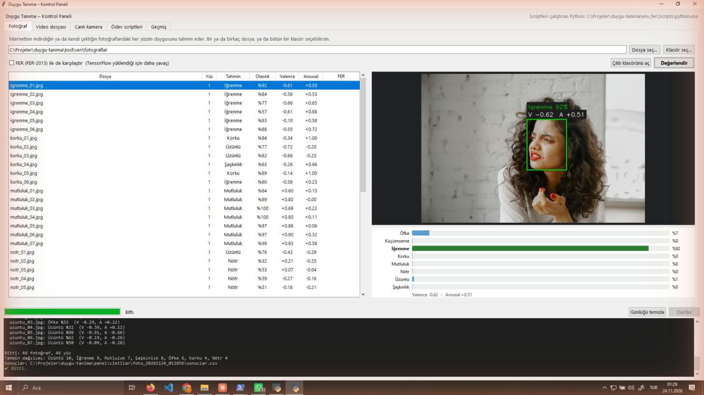

# Yüz İfadesinden Duygu Tanıma

**FER, OpenFace ve AffectNet ile gerçek zamanlı bir duygu tanıma sistemi**

Görüntü İşleme dersi proje ödevi · Konu (hoca önerisi): *Duygu Tanıma*

| Ekip | Öğrenci no |
|---|---|
| Alper Ekrem Demir | 2220656022 |
| Mehmet Ali Kıkıçoğlu | 2220656044 |

Bu repo projenin kaynak kodlarını, teknik ayrıntılarını, kullanım kılavuzunu ve raporunu içerir.

- 📄 Rapor: [`docs/Duygu_Tanima_Raporu.pdf`](docs/Duygu_Tanima_Raporu.pdf)

---

## 1. Projenin amacı

Kameradan ya da fotoğraftan gelen görüntüde yüzü bulan, yüz ifadesinden duyguyu tahmin eden ve bu tahmini zaman içinde izleyen bir sistem geliştirmek. Ödevde önerilen üç yöntemin her birine sistemde ayrı bir görev verildi:

| Yöntem | Türü | Sistemdeki görevi |
|---|---|---|
| **AffectNet** | ~1 milyon yüzlük, duygu ve valence–arousal etiketli veri seti | Bu veriyle eğitilmiş model (HSEmotion) duyguyu **tahmin eder** |
| **FER** (FER-2013 + `fer` kütüphanesi) | 48×48 gri, ~35 bin yüzlük veri seti ve onunla eğitilmiş kütüphane | Aynı yüz ona da verilir, sonuçlar **kıyaslanır** |
| **OpenFace 2.2** | Yüzdeki kas hareketlerini (Action Unit) ölçen araç | Modellerin kararlarını kas hareketleriyle **açıklar** |

Kullanım alanları: müşteri hizmetleri (gerilen müşteriyi fark etmek), terapi (seans boyunca duygu seyri), oyun (zorluğu heyecana göre ayarlamak).

## 2. Kullanılan görüntü işleme yöntemleri ve kütüphaneler

| Kütüphane / araç | Sürüm | Ne için kullanıldı |
|---|---|---|
| **OpenCV** (`opencv-python`, `opencv-contrib-python`) | 4.14 | Kamera ve video okuma, renk dönüşümü (BGR→RGB, gri), Haar Cascade, YuNet (`cv2.FaceDetectorYN`), çizim |
| **YuNet** (`face_detection_yunet_2023mar.onnx`, OpenCV Zoo) | 2023 | CNN tabanlı yüz tespiti: kutu + 5 yüz noktası + güven skoru |
| **Haar Cascade** (`haarcascade_frontalface_default.xml`) | OpenCV ile gelir | Klasik yüz tespiti, YuNet ile karşılaştırma için |
| **hsemotion-onnx** + **onnxruntime** | 0.3.1 / 1.23 | AffectNet ile eğitilmiş EfficientNet-B0 modelleri: `enet_b0_8_va_mtl` (8 duygu + valence + arousal, demo ve panel), `enet_b0_8_best_afew` (karşılaştırma deneyi) |
| **fer** + **TensorFlow / Keras** | 25.10.3 / 2.21 | FER-2013 ile eğitilmiş CNN, 7 duygu (karşılaştırma modeli) |
| **OpenFace** | 2.2.0 (Windows) | `FaceLandmarkImg.exe` ile fotoğraflarda 17 Action Unit yoğunluğu |
| **NumPy** | 2.2 | Dizi işlemleri, üstel yumuşatma, hareketli ortalama |
| **scikit-learn** | 1.7 | Doğruluk, makro F1, karışıklık matrisi |
| **Matplotlib** | 3.10 | Oturum özeti, karışıklık matrisi, AU ısı haritası grafikleri |
| **Tkinter** | Python ile gelir | Kontrol paneli arayüzü |

## 3. Sistem nasıl çalışır?

```
Kamera karesi / fotoğraf / video
   │
   ▼
1) Yüzü bul ─── YuNet (CNN, kullanılan)        Haar Cascade (klasik, yalnızca karşılaştırma)
   │
   ▼
2) Yüzü ayır ── kutu her yönden %15 genişletilip kırpılır, BGR → RGB
   │
   ├──► 3) HSEmotion (AffectNet)  → 8 duygu olasılığı + valence + arousal   ← ana model
   ├──► 3') fer (FER-2013)        → 7 duygu olasılığı                       ← karşılaştırma
   │
   ▼
4) Zamanla izle ── üstel yumuşatma: yeni = 0,6·eski + 0,4·tahmin
   │
   ▼
5) Göster ve özetle ── kutu + etiket, 8 duygu çubuğu, valence–arousal dairesi;
                       oturum bitince zaman grafiği, baskın duygu payları, olumsuz anlar (valence < −0,2)

Açıklama kolu: aynı test fotoğrafları OpenFace ile 17 kas hareketine (Action Unit) ayrılır.
```

## 4. Klasör yapısı

```
yuz-ifadesinden-duygu-tanima/
├── README.md                 ← bu dosya (teknik detaylar + kullanım kılavuzu)
├── kod/                      ← ödev kodları (deneyler ve ana demo)
│   ├── requirements_fer.txt, requirements_torch.txt
│   ├── yuz_tespit.py              Haar Cascade ile canlı yüz tespiti
│   ├── yuz_tespit_yunet.py        YuNet ile canlı yüz tespiti (5 yüz noktası)
│   ├── duygu_demo.py              ANA DEMO: canlı duygu tanıma + oturum kaydı
│   ├── oturum_ozeti.py            görüşmenin duygu özeti (uygulama senaryosu)
│   ├── karsilastirma_canli.py     canlı FER–HSEmotion karşılaştırması (1–7 tuşlarıyla etiket)
│   ├── degerlendirme.py           doğruluk, makro F1, karışıklık matrisi
│   ├── foto_indir.py              test fotoğraflarını Pexels'ten indirir
│   ├── foto_analiz.py             fotoğraflarda Haar–YuNet ve FER–HSEmotion deneyleri
│   ├── foto_deneyleri.py          bütün fotoğraf deneylerini sırayla çalıştırır
│   ├── au_analiz_foto.py          OpenFace çıktısından AU ısı haritası
│   ├── video_kaydet.py, au_analiz.py   video üzerinden OpenFace analizi (ek)
│   ├── modeller/                  YuNet modeli (.onnx)
│   ├── veri/                      foto_listesi.csv, kaynaklar.csv (fotoğraflar indirilerek oluşur)
│   └── ciktilar/                  deneylerin ürettiği CSV, TXT ve grafikler
├── panel/                    ← kontrol paneli (ek arayüz, ödev kodlarından ayrı)
│   ├── Paneli_Ac.bat              paneli çift tıklayarak açar
│   ├── panel.py                   Tkinter arayüzü
│   ├── motor.py                   ortak motor: YuNet + HSEmotion, çizim, özet
│   ├── foto_degerlendir.py, video_degerlendir.py, canli_degerlendir.py
│   └── README.md
└── docs/                     ← rapor (PDF) ve arayüz ekran görüntüleri
```

## 5. Kurulum

Gereksinimler: Windows 10/11, Python 3.10, web kamerası (canlı demo için). GPU gerekmez.

```powershell
git clone https://github.com/KIKICOGLU/yuz-ifadesinden-duygu-tanima.git
cd yuz-ifadesinden-duygu-tanima

python -m venv env_fer
.\env_fer\Scripts\Activate.ps1
pip install -r kod\requirements_fer.txt
pip install --no-deps --force-reinstall opencv-contrib-python==4.14.0.94
```

> Son satır önemli: `fer` paketi `opencv-contrib-python`, `hsemotion-onnx` ise `opencv-python` ister. İkisi aynı `cv2` klasörüne yazdığı için contrib paketi **en son ve aynı sürümle** kurulur.

İlk çalıştırmada HSEmotion modeli (~16 MB) internetten `~/.hsemotion/` klasörüne otomatik iner.

Test fotoğrafları (46 adet, Pexels Lisansı) repoya konmadı; indirmek için:

```powershell
python kod\foto_indir.py
```

OpenFace (yalnızca kas hareketi analizi için): [OpenFace 2.2.0 Windows paketi](https://github.com/TadasBaltrusaitis/OpenFace/releases) `araclar\OpenFace_2.2.0_win_x64\` klasörüne açılır.

## 6. Kullanım kılavuzu

Projeyi iki yoldan çalıştırabilirsiniz: **kontrol panelinden** ya da **VS Code / terminalden elle**.

### 6.1 Kontrol paneli

`panel\Paneli_Ac.bat` dosyasına çift tıklayın (ya da `env_fer` etkinken `python panel\panel.py`). Panel yanlış bir Python ile açılırsa kendini `env_fer` ile yeniden başlatır.

| Sekme | Ne yapar |
|---|---|
| **Fotoğraf** | Bir ya da birkaç fotoğraf ya da bütün bir klasör seçilir, **Değerlendir**'e basılır. Her yüz için tahmin, olasılık, valence ve arousal tabloya gelir; satıra tıklayınca işaretli fotoğraf ve 8 duygunun çubukları görünür. İstenirse FER ile karşılaştırır. |
| **Video dosyası** | Kayıtlı bir video kare kare işlenir; valence–arousal zaman grafiği, baskın duygu payları, olumsuz anlar ve işaretli video üretilir. |
| **Canlı kamera** | Kameradan anlık duygu tanıma; `q` ya da **Bitir ve kaydet** ile bitince özet çıkar. Varsayılan olarak yalnızca sayılar kaydedilir, görüntü kaydedilmez. |
| **Ödev scriptleri** | `kod/` klasöründeki scriptleri değiştirmeden çalıştırır; **VS Code'da aç** ile dosyayı açar. |
| **Geçmiş** | Panelden yapılan önceki analizleri listeler ve özetlerini gösterir. |



Alttaki günlükte her işin tam komutu yazılır; aynı komut VS Code terminalinde panelsiz de çalışır. Panelin çıktıları `panel/ciktilar/` altında tarihli klasörlere yazılır.

### 6.2 VS Code / terminal

VS Code'da yorumlayıcı olarak `env_fer`'i seçin (sağ alt köşe), ardından istediğiniz dosyayı ▶ ile çalıştırın ya da terminalde:

```powershell
.\env_fer\Scripts\Activate.ps1

python kod\duygu_demo.py        # canlı demo  (q: çıkış, s: ekran görüntüsü)
python kod\oturum_ozeti.py      # demo kapandıktan sonra görüşme özeti
python kod\foto_deneyleri.py    # raporun bütün fotoğraf deneylerini yeniden üretir
python kod\yuz_tespit.py        # Haar Cascade   (q: çıkış)
python kod\yuz_tespit_yunet.py  # YuNet          (q: çıkış)
python kod\karsilastirma_canli.py   # FER–HSEmotion yan yana; 1–7 tuşlarıyla etiketli kayıt
python kod\degerlendirme.py foto_sonuclari.csv

python panel\foto_degerlendir.py C:\Resimler --fer   # panelsiz fotoğraf değerlendirme
python panel\video_degerlendir.py gorusme.mp4 --adim 3
python panel\canli_degerlendir.py --kamera 0
```

Bütün ödev scriptleri modeli `kod/modeller/` klasöründen okur ve çıktıları `kod/ciktilar/` klasörüne yazar; hangi klasörden çalıştırıldıkları önemli değildir.

## 7. Kodun kritik bölümleri

**Yüz tespiti (YuNet):** her kareye kutu, 5 yüz noktası ve güven skoru döner.

```python
dedektor = cv2.FaceDetectorYN.create(YUZ_MODELI, "", (genislik, yukseklik), score_threshold=0.8)
_, yuzler = dedektor.detect(kare)          # her satır: x, y, w, h, 5 nokta (10 sayı), skor
```

**Yüzü ayırma:** alın ve çene kaybolmasın diye kutu %15 genişletilir; OpenCV BGR verir, model RGB bekler.

```python
def yuzu_kirp(kare, x, y, w, h, pay=0.15):
    H, W = kare.shape[:2]
    dx, dy = int(w * pay), int(h * pay)
    return kare[max(0, y - dy):min(H, y + h + dy), max(0, x - dx):min(W, x + w + dx)]

rgb = cv2.cvtColor(kirpik, cv2.COLOR_BGR2RGB)
```

**Duygu tahmini (AffectNet modeli):** tek çağrıda 8 duygu olasılığı + valence + arousal.

```python
duygu_modeli = HSEmotionRecognizer(model_name="enet_b0_8_va_mtl")
_, skorlar = duygu_modeli.predict_emotions(rgb, logits=False)   # 10 değer
```

**Zamanla izleme:** kareden kareye titremeyi azaltan üstel hareketli ortalama.

```python
duzgun = skorlar if duzgun is None else 0.6 * duzgun + 0.4 * skorlar
```

**Adil karşılaştırma:** aynı yüz kutusu iki modele birden verilir.

```python
_, ham = hse.predict_emotions(cv2.cvtColor(kirpik, cv2.COLOR_BGR2RGB), logits=False)
fer_sonuc = fer_modeli.detect_emotions(goruntu, face_rectangles=[(x, y, w, h)])
```

**Oturum özeti:** valence −0,2'nin altına düşen anlar “olumsuz” sayılır.

```python
olumsuz_sure = sureler[v_duz < -0.2].sum()
```

## 8. Sonuçlar (özet)

46 stok fotoğraf, 7 duygu (ayrıntılar raporda):

| Deney | Sonuç |
|---|---|
| Yüz bulma | YuNet 46/46 (ort. güven 0,91) · Haar Cascade 39/46 (%85; 4 kaçırma, 3 yanlış alarm) |
| Duygu tanıma | HSEmotion (AffectNet) doğruluk %73,9, makro F1 0,74 · FER (FER-2013) doğruluk %56,5, makro F1 0,49 |
| Zor duygular | FER iğrenme ve korkuyu hiç tanıyamadı (%0); 6 iğrenmenin 5'ini öfke sandı |
| OpenFace | 42/46 fotoğrafta ölçüm; öfke ve iğrenme aynı kasları (AU4, AU7, AU9, AU10) kullanıyor |
| Görüşme senaryosu | Valence gerilmeyi duygu adından önce yakaladı; görüşmenin %46'sı olumsuz işaretlendi |

## 9. Etik ve veri

- Testlerde kimsenin yüzü izinsiz kaydedilmedi; ücretsiz lisanslı (Pexels) stok fotoğraflar kullanıldı. Fotoğrafçılar ve kaynak sayfaları `kod/veri/kaynaklar.csv` dosyasında.
- Canlı kamera varsayılan olarak görüntü kaydetmez, yalnızca sayısal tahminleri saklar; hiçbir veri internete gönderilmez.
- Yüzden çıkarılan duygu kesin bir ölçüm değil, insanın değerlendirmesine sunulan bir ipucudur.

## 10. Kaynaklar

- Ekman & Friesen (1971, 1978) – temel duygular ve FACS · Russell (1980) – valence–arousal modeli
- Viola & Jones (2001) – Haar Cascade · Wu vd. (2023) – YuNet
- Goodfellow vd. (2013) – FER-2013 · Mollahosseini vd. (2019) – AffectNet
- Baltrušaitis vd. (2018) – OpenFace 2.0 · Savchenko (2022) – HSEmotion · Shenk – `fer`

**Yapay zekâ kullanım beyanı:** Kodların yazılmasında, test fotoğraflarının seçilmesinde ve raporun hazırlanmasında bir yapay zekâ asistanından (Claude) yararlanılmıştır. Deneyler proje ekibi tarafından çalıştırılmış ve sonuçlar ekip tarafından kontrol edilmiştir.
